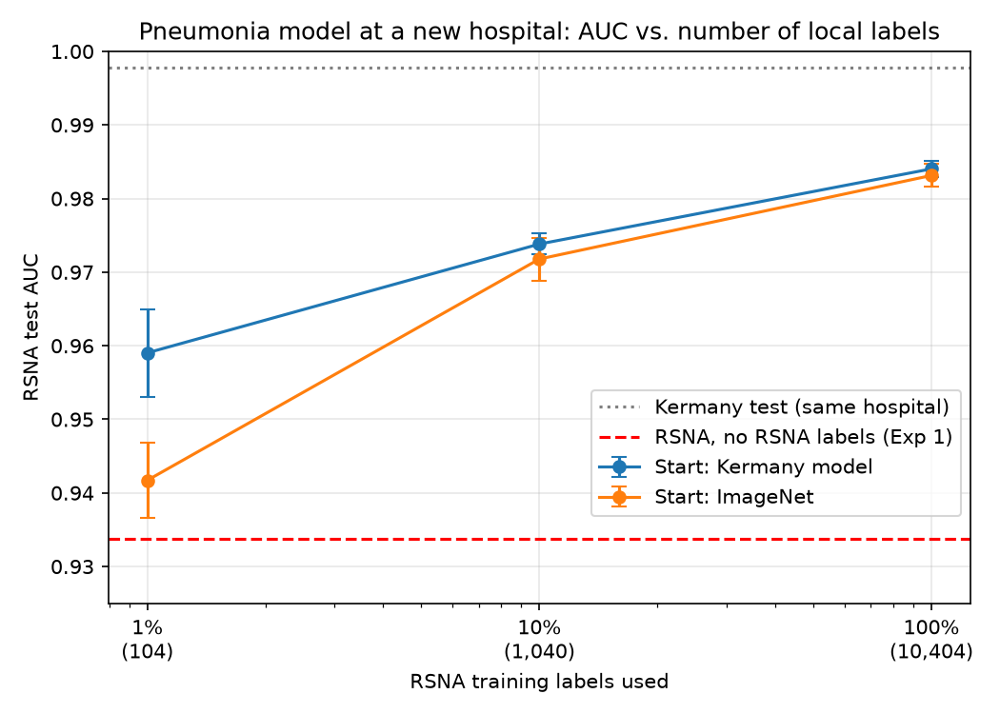

# Does It Generalize? Pneumonia Detection on Chest X-rays Across Hospitals

A pneumonia classifier trained on one hospital's X-rays scores almost perfectly on that hospital's test set. This project measures what happens when the same model meets X-rays from a different hospital, and how many labels from the new hospital it takes to recover.



## Key findings

- **The model breaks at a new hospital, mostly through false alarms.** Trained on pediatric X-rays (Kermany), a ResNet-18 reaches **AUC 0.998** on held-out Kermany patients but **AUC 0.934** on adult X-rays from RSNA. With the decision threshold frozen from the original hospital, specificity falls from **0.996 to 0.784**: about 286 of 1,321 healthy adults are flagged as pneumonia.
- **A few local labels recover most of the drop.** Fine-tuning on **104 labelled RSNA images (1%)** raises AUC to **0.959 ± 0.006**; 1,040 images (10%) give **0.974**; all 10,404 give **0.984**.
- **Training at another hospital helps when labels are scarce.** With 1% of RSNA labels, starting from the Kermany model beats starting from ImageNet (**AUC 0.959 vs 0.942**, specificity **0.76 vs 0.69** at about 95% sensitivity, roughly 90 fewer false alarms on the test set). The gap disappears at 10% and 100%.

## Data

|                 | Kermany                                               | RSNA                                                                                 |
| --------------- | ----------------------------------------------------- | ------------------------------------------------------------------------------------ |
| Patients        | Children aged 1–5                                     | Adults                                                                               |
| Source          | Guangzhou Women and Children's Medical Center, China  | NIH Clinical Center, USA (RSNA Pneumonia Detection Challenge)                        |
| Labels          | Normal / Pneumonia                                    | Normal / Lung Opacity (the third class, "No Lung Opacity / Not Normal", is excluded) |
| Pneumonia share | ~73%                                                  | ~40%                                                                                 |
| Split used      | 70 / 15 / 15 **by patient**: 4,171 / 779 / 906 images | 70 / 15 / 15: 10,404 / 2,229 / 2,230 images (one image per patient)                  |

Kermany's original split has only 16 validation images and puts some patients' X-rays in more than one set, so it was re-split by patient ID (`split_data.py`). RSNA DICOMs are converted once to 224×224 PNGs (`prepare_rsna.py`). Both split files are committed, so every result uses exactly the same images.

## Method

**Baseline (`train.py`).** ImageNet-pretrained ResNet-18 with a new 1-output head, 224×224 inputs, weighted binary cross-entropy (to balance the classes), Adam (lr 1e-4), 5 epochs, keeping the epoch with the best validation AUC.

**Experiment 1: does it generalize? (`evaluate.py`).** The decision threshold is set on Kermany validation (the highest threshold that still catches ≥ 95% of pneumonia) and **frozen**. The model is then scored once on the Kermany test set and once on the RSNA test set.

**Experiment 2: how many new-hospital labels does it take? (`finetune.py`).** Fine-tune on 1%, 10% and 100% of RSNA train, starting either from the Kermany model or from plain ImageNet weights, with the same recipe for both (Adam, lr 1e-4; 30 / 10 / 5 epochs for 1 / 10 / 100%). Subsets are nested (within a seed, the 1% is part of the 10%), and both starting points see the same images. The best epoch and a new 95%-sensitivity threshold are chosen on RSNA validation, then each model is scored once on the **same RSNA test set as Experiment 1**. 3 seeds per setting, 18 runs in total.

## Results

**Experiment 1** (threshold frozen from Kermany validation):

| Test set                | AUC    | Sensitivity | Specificity |
| ----------------------- | ------ | ----------- | ----------- |
| Kermany (same hospital) | 0.9978 | 0.9654      | 0.9959      |
| RSNA (new hospital)     | 0.9337 | 0.9208      | 0.7835      |

**Experiment 2** (RSNA test, mean ± standard deviation over 3 seeds; specificity at ~95% sensitivity):

| RSNA labels   | AUC, Kermany start | AUC, ImageNet start | Specificity, Kermany start | Specificity, ImageNet start |
| ------------- | ------------------ | ------------------- | -------------------------- | --------------------------- |
| 1% (104)      | **0.959 ± 0.006**  | 0.942 ± 0.005       | **0.76 ± 0.02**            | 0.69 ± 0.02                 |
| 10% (1,040)   | 0.974 ± 0.001      | 0.972 ± 0.003       | 0.85 ± 0.02                | 0.82 ± 0.03                 |
| 100% (10,404) | 0.984 ± 0.001      | 0.983 ± 0.002       | 0.90 ± 0.00                | 0.89 ± 0.01                 |

Per-run numbers are in `exp2_results.csv`, and per-epoch validation AUCs in `exp2_log.txt`.

## Limitations

- **The shift has several causes at once.** Kermany vs RSNA differs in patient age, country, hospital, scanners and label definition (a pneumonia diagnosis vs radiologist-marked lung opacity). This project measures the combined effect and cannot say which factor drives the drop.
- **Validation labels in the low-label runs.** Every run picks its best epoch and threshold on the full RSNA validation set (2,229 labelled images), even when training on only 104. A hospital with 104 labels would not have that many more for validation, so the 1% and 10% results are somewhat optimistic (see Oliver et al., 2018).
- **Only 3 seeds.** Only the 1% gap between the two starting points is clearly larger than the spread between seeds. The 10% and 100% differences are within noise.
- **Different operating points.** Experiment 1 uses the frozen Kermany threshold (92% sensitivity on RSNA), while Experiment 2 re-chooses the threshold on RSNA (~95% sensitivity), so their specificities are not directly comparable. AUC is the comparable metric.
- **One architecture, no data augmentation, 224×224 resolution.**

## Next steps

- **Grad-CAM** heatmaps, to check whether the model looks at the lungs or at shortcuts such as text markers and image borders.
- **Using the unlabelled RSNA images.** In the 1% runs, about 10,300 RSNA training images go unused. Semi-supervised fine-tuning could use them.
- A realistic low-label protocol, with a validation set sized to the label budget.

## How to run

```bash
pip install torch torchvision scikit-learn pillow pydicom matplotlib
```

Download the [Kermany dataset](https://www.kaggle.com/datasets/paultimothymooney/chest-xray-pneumonia) into `data/kermany/` and the [RSNA Pneumonia Detection Challenge data](https://www.kaggle.com/c/rsna-pneumonia-detection-challenge) into `data/rsna/`, then:

```bash
python split_data.py      # Kermany patient-level split -> kermany_split.csv
python train.py           # baseline on Kermany -> best_model.pt
python prepare_rsna.py    # RSNA: DICOM -> PNG, split -> rsna_split.csv
python evaluate.py        # Experiment 1
python finetune.py        # Experiment 2 (18 runs, ~2 h on an Apple M4 Pro)
python plot_results.py    # -> figures/auc_vs_labels.png
```

## Repository structure

| File              | Purpose                                                          |
| ----------------- | ---------------------------------------------------------------- |
| `count_images.py` | Counts images per class in Kermany's original folders            |
| `split_data.py`   | Kermany patient-level 70/15/15 split                             |
| `data.py`         | Shared code: reading split files, image transform, `XrayDataset` |
| `train.py`        | Baseline training on Kermany                                     |
| `evaluate.py`     | Threshold selection and Experiment 1                             |
| `prepare_rsna.py` | RSNA class selection, DICOM to PNG conversion, split             |
| `finetune.py`     | Experiment 2                                                     |
| `plot_results.py` | Results figure                                                   |

## References

- Kermany et al. (2018). _Identifying Medical Diagnoses and Treatable Diseases by Image-Based Deep Learning._ Cell. [doi:10.1016/j.cell.2018.02.010](https://doi.org/10.1016/j.cell.2018.02.010)
- Zech et al. (2018). _Variable generalization performance of a deep learning model to detect pneumonia in chest radiographs: A cross-sectional study._ PLOS Medicine. [doi:10.1371/journal.pmed.1002683](https://doi.org/10.1371/journal.pmed.1002683)
- Oliver et al. (2018). _Realistic Evaluation of Deep Semi-Supervised Learning Algorithms._ NeurIPS. [arXiv:1804.09170](https://arxiv.org/abs/1804.09170)
